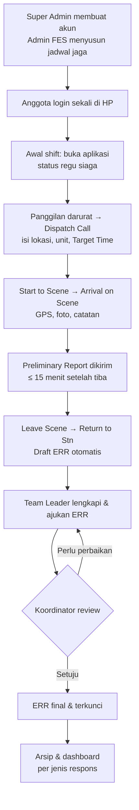
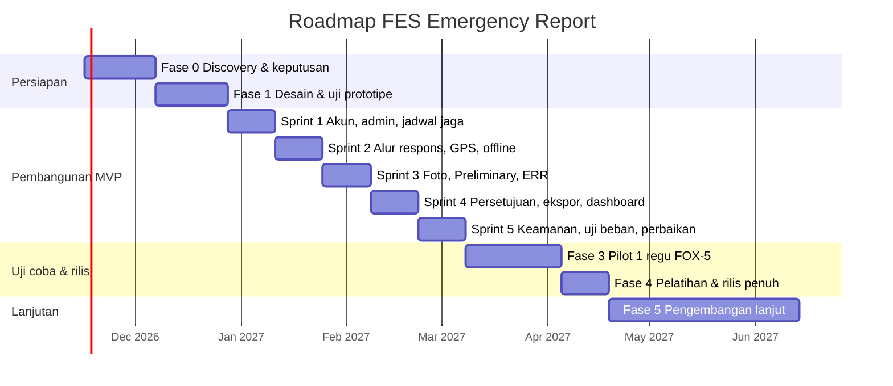

# Product Requirements Document (PRD)
# FES Emergency Report

| Item | Keterangan |
|---|---|
| Nama produk | FES Emergency Report |
| Pemilik produk | Fire Emergency & Service (FES) – PT Vale Indonesia |
| Platform | Mobile (Android/iOS) + Web Dashboard |
| Lokasi penggunaan | Kolaka, Sulawesi Tenggara |
| Versi dokumen | 1.7 (Draft – backend PHP + MySQL, data tersimpan di server) |
| Tanggal | 12 November 2026 |
| Status | Draft – menunggu review tim FES |

> **Catatan:** Bagian bertanda **[ASUMSI]** adalah perkiraan penulis karena informasinya belum tersedia. Mohon diverifikasi oleh tim FES.

---

## 1. Latar Belakang

Saat ini tim Fire Emergency & Service (FES) PT Vale Indonesia membuat laporan respons darurat secara **manual menggunakan Excel**. Ada dua jenis laporan yang harus dibuat:

1. **Preliminary Report**: laporan awal yang harus segera dikirim setelah kejadian.
2. **ERR (Emergency Response Report)**: laporan lengkap dan resmi setelah respons ditutup.

### Masalah yang terjadi

| # | Masalah | Dampak |
|---|---|---|
| 1 | Laporan diketik manual di Excel | Memakan waktu dan rawan salah ketik, terutama pada jam dan durasi |
| 2 | Satu orang harus tetap **standby di kantor** untuk membuat laporan | Tim di lapangan tidak bisa turun dengan **kekuatan penuh (full team)** |
| 3 | Waktu (berangkat, tiba, padam, dan seterusnya) dicatat dari ingatan atau radio | Data waktu respons kurang akurat dan sulit diaudit |
| 4 | Jarak tempuh diperkirakan, bukan diukur | Tidak ada data objektif untuk evaluasi waktu respons |
| 5 | Foto bukti tersebar di HP pribadi atau grup chat | Sulit dikumpulkan, tidak terarsip, dan rawan hilang |
| 6 | Arsip laporan berupa file Excel terpisah-pisah | Sulit mencari data historis dan membuat rekap statistik |

---

## 2. Tujuan Produk

| # | Tujuan |
|---|---|
| G1 | **Menghilangkan kebutuhan petugas standby di kantor** untuk membuat laporan, sehingga seluruh tim dapat turun ke lapangan |
| G2 | **Mencatat timeline respons secara otomatis dan akurat** melalui tombol aksi yang ditekan sesuai kejadian aktual |
| G3 | **Mengukur jarak dan rute** dari pos ke TKP menggunakan GPS |
| G4 | **Menghasilkan Preliminary Report dan ERR secara otomatis** dari data yang tercatat |
| G5 | **Menyimpan foto evidence** yang terhubung langsung ke setiap kejadian |
| G6 | **Menyediakan arsip dan dashboard** data respons untuk evaluasi dan pelaporan manajemen |

### Di luar cakupan (Non-Goals) versi 1

- Menggantikan sistem dispatch atau radio komunikasi yang sudah ada.
- Integrasi otomatis dengan sistem HSE atau ERP perusahaan (direncanakan untuk fase berikutnya).
- Navigasi turn-by-turn seperti Google Maps.
- Fitur chat antar anggota tim.

---

## 3. Pengguna & Persona

### 3.1 Peran pengguna

| Peran | Siapa | Yang bisa dilakukan | Platform |
|---|---|---|---|
| **Tim FES** (Crew) | Anggota regu FES Pomalaa | Mencatat tahapan respons saat ditunjuk, foto, catatan, menandai personel tiba, melihat Jadwal saya | Aplikasi HP |
| **Team Leader** | Komandan regu yang bertugas (4 orang: satu per regu) | Semua hak Tim FES + Dispatch Call, mengisi Target Time, mengirim Preliminary, mengajukan ERR, **melihat dashboard** | Aplikasi HP + web |
| **Koordinator FES** | Deri Nurjaya Putra | **Melihat dashboard** (web dan aplikasi). **Tidak bisa** memakai fitur respons darurat | Web + aplikasi HP |
| **Admin FES** | Okky Nurhamni Muda | Mengatur regu & jadwal jaga, unit, master data, template, aturan respons, penerima laporan; mengubah regu/peran anggota (terbatas, lihat 5.12); **melihat dashboard hanya baca** (tanpa unduh data) | Web (dashboard juga di aplikasi) |
| **Super Admin (IT)** | Eghy Agus Rinaldi | **Satu-satunya yang bisa menambah akun.** Pengaturan sistem & keamanan, hak Admin FES, semua halaman admin, **melihat dashboard** | Web (dashboard juga di aplikasi) |

Peran **Supervisor** dan **Viewer** dari versi sebelumnya **dihapus**. Pemantauan lewat dashboard sekarang dilakukan Team Leader, Koordinator, Admin FES, dan Super Admin.

**Matriks akses**

| Peran | Respons darurat (aplikasi) | Dashboard | Unduh data dashboard | Halaman admin | Tambah akun |
|---|---|---|---|---|---|
| Tim FES | ✅ | ❌ | – | ❌ | ❌ |
| Team Leader | ✅ | ✅ | ✅ | ❌ | ❌ |
| Koordinator FES | ❌ | ✅ | ✅ | ❌ | ❌ |
| Admin FES | ❌ | ✅ hanya baca | ❌ | ✅ | ❌ |
| Super Admin (IT) | ❌ | ✅ | ✅ | ✅ (termasuk Sistem & keamanan) | ✅ |

Akun yang tidak punya akses ke suatu halaman tetap di halaman masuk dan mendapat pesan yang jelas, misalnya "Dashboard hanya untuk Team Leader, Koordinator, Admin FES, dan Super Admin". Penolakan karena peran tidak dihitung sebagai salah kata sandi.

**Data awal pengguna:** 16 anggota FES Pomalaa dari daftar resmi (nama + BN), terdiri dari 4 Team Leader dan 12 Tim FES, dibagi ke **4 regu: Alpha, Bravo, Charlie, dan Delta** (masing-masing 1 Team Leader + 3 anggota; susunan anggota per regu bisa diubah Admin FES). Ditambah akun Koordinator, Admin FES, dan Super Admin. Data diimpor oleh Super Admin.

### 3.2 Persona

**Persona 1: Andi, Team Leader FES**
- Bertanggung jawab memimpin regu saat ada panggilan darurat.
- Saat respons, kedua tangannya sering sibuk dan ia memakai sarung tangan APD.
- Kebutuhan: **sesedikit mungkin interaksi dengan HP**, tombol besar, dan satu ketukan per tahapan.

**Persona 2: Rina, Koordinator FES** *(sebelumnya Supervisor; persona contoh)*
- Bertugas menyerahkan laporan ke manajemen dan departemen HSE.
- Kebutuhan: laporan **cepat jadi, akurat, dan format standar**, serta dapat diekspor ke PDF/Excel.

**Persona 3: Pak Budi, Manajer**
- Kebutuhan: melihat **tren kejadian, rata-rata waktu respons**, dan arsip kejadian kapan saja.

---

## 4. User Stories

| ID | Sebagai… | Saya ingin… | Supaya… | Prioritas |
|---|---|---|---|---|
| US-01 | Team Leader | menekan **"Mulai Respons"** saat tim berangkat | waktu berangkat dan titik awal GPS tercatat otomatis | Must |
| US-02 | Team Leader | menekan tombol tahapan berikutnya (Tiba di TKP, Pemadaman, dll.) | setiap waktu tahapan tercatat tanpa menulis manual | Must |
| US-03 | Team Leader | melihat jarak tempuh dan durasi berjalan di layar | saya tahu progres respons secara real time | Must |
| US-04 | Petugas | mengambil foto evidence langsung dari aplikasi | foto otomatis tersimpan dengan waktu dan koordinat GPS | Must |
| US-05 | Team Leader | mengisi data singkat kejadian (jenis, lokasi, korban) | Preliminary Report bisa langsung dibuat | Must |
| US-06 | Team Leader | menekan **"Leave Scene / Case Closed"** lalu **"Return to Stn"** saat tiba di fire station | respons resmi ditutup dan ERR draft dibuat otomatis | Must |
| US-07 | Koordinator | menerima notifikasi saat Preliminary Report siap | saya bisa segera meneruskannya ke manajemen | Must |
| US-08 | Koordinator | mereview, mengedit, dan menyetujui ERR | laporan final sesuai standar perusahaan | Must |
| US-09 | Koordinator | mengekspor laporan ke PDF dan Excel | saya bisa mengirimnya sesuai format yang berlaku | Must |
| US-10 | Manajemen | melihat dashboard statistik respons yang bisa dipecah per jenis respons (FIRE, ALARM, MVA, RESCUE, HAZMAT, OIL SPILL, MEDICAL) | saya bisa mengevaluasi kinerja tim untuk tiap jenis kejadian | Should |
| US-11 | Koordinator | mencari arsip kejadian berdasarkan tanggal, jenis, dan lokasi | data historis mudah ditemukan | Must |
| US-12 | Petugas | tetap bisa mencatat tahapan saat sinyal hilang | data tidak hilang ketika berada di area tanpa sinyal | Must |
| US-13 | Koordinator | melihat posisi tim yang sedang respons di peta | saya bisa memantau tanpa harus berada di lapangan | Should |
| US-14 | Admin | mengelola akun petugas, unit kendaraan, dan pos | master data selalu terbarui | Must |
| US-15 | Team Leader | layar otomatis menampilkan peta penuh dan data respons inti saat HP tidak disentuh | progres respons terbaca sekilas tanpa membuka menu, misalnya saat HP terpasang di dashboard kendaraan | Should |
| US-16 | Petugas | mendapat notifikasi singkat setiap kali menekan tombol atau menyimpan data | yakin tindakan sudah tercatat, atau tahu apa yang perlu diperbaiki | Must |

---

## 5. Fitur Utama

### 5.1 Tombol Respons (Response Timeline Button), fitur inti

Satu tombol besar di layar utama yang **berubah sesuai tahapan respons**. Setiap kali ditekan, sistem mencatat **waktu (timestamp)** dan **koordinat GPS** pada saat itu.

#### Tahapan respons

Tombol **wajib** dipetakan langsung ke 4 kolom waktu di form ERR (blok *RESPON TIME*). Tombol **tambahan** tidak punya kolom sendiri di ERR, tetapi otomatis menjadi baris kronologi bertimestamp di kolom *Detail Informasi*.

| # | Tahapan (Label tombol) | Jenis | Kolom ERR | Data yang tercatat otomatis |
|---|---|---|---|---|
| 1 | **Dispatch Call** (panggilan diterima) | Wajib | `Dispatch Call` | Waktu panggilan diterima, sumber info (*Informasi di Terima dari*, misalnya ERT Coordinator). Tim respons juga **mengisi Target Time** untuk lokasi ini (wajib diisi sebelum tombol Start to scene aktif) |
| 2 | **Start to Scene** (berangkat) | Wajib | `Start to scene` | Waktu berangkat, titik GPS awal, Response Station, unit & personel; **pelacakan rute dimulai** |
| 3 | **Arrival on Scene** (tiba di TKP) | Wajib | `Arrival on scene` | Waktu tiba, titik GPS TKP, **jarak tempuh → `Mileage (KM)`**; pelacakan rute berhenti; **memicu Preliminary Report** |
| 4 | Size-up / Code (misalnya *code red*) | Tambahan | Kronologi | Waktu + kode situasi |
| 5 | Mulai Pemadaman / Penanganan | Tambahan | Kronologi | Waktu + metode/peralatan (misalnya Jet Shooter) |
| 6 | Api Terkendali / Padam / Reposisi / Dihentikan | Tambahan | Kronologi | Waktu + catatan singkat |
| 7 | Leave Scene / Case Closed | Tambahan | Kronologi | Waktu tim meninggalkan TKP ("Case closed"); pelacakan rute pulang dimulai |
| 8 | **Return to Stn** (tiba di fire station) | Wajib | `Return to Stn` | Waktu tim **tiba kembali di fire station**, jarak pulang; respons resmi ditutup dan **ERR draft dibuat** |

Selain tombol tahapan, ada tombol **"+ Catatan"** untuk menambahkan kejadian penting kapan saja, misalnya *"Api yang mengarah ke pesantren berhasil dipadamkan"*. Waktu catatan terisi otomatis, dan teksnya bisa diketik atau didiktekan dengan suara. Catatan ini menjadi baris kronologi ERR dengan format `- HH:MM <keterangan>`, sama seperti yang sekarang diketik manual.

Daftar tahapan tambahan **bisa dikonfigurasi Admin** sesuai SOP FES dan jenis respons (FIRE, RESCUE, MVA, HAZMAT, dan lain-lain).

#### Aturan & perilaku

- Tombol berukuran besar (minimal 1/3 layar) dan kontras tinggi agar **bisa ditekan dengan sarung tangan**.
- Tahapan berjalan berurutan. Tahapan yang tidak relevan dapat **dilewati** dengan konfirmasi.
- Ada fitur **Undo** dalam 10 detik bila tombol tertekan tidak sengaja.
- Setiap koreksi waktu setelah undo hanya boleh dilakukan Team Leader/Koordinator dan **tercatat di log audit** (nilai lama, nilai baru, siapa, dan kapan).
- Layar menampilkan: tahapan saat ini, stopwatch sejak berangkat, jarak tempuh berjalan, dan peta mini.
- Satu kejadian dapat diikuti **lebih dari satu unit**. Setiap unit memiliki timeline sendiri yang digabung dalam satu laporan kejadian.

### 5.2 Pelacakan GPS & Jarak

- Merekam rute perjalanan dari titik berangkat sampai TKP (interval ±5 detik atau setiap 20 meter).
- Menghitung **jarak tempuh aktual** berdasarkan rute, bukan garis lurus.
- Menyimpan koordinat TKP dan menampilkannya di peta.
- Mendukung **mode offline**: titik GPS tetap direkam di perangkat dan disinkronkan saat sinyal kembali (GPS satelit tidak membutuhkan internet).
- Menampilkan peringatan jika GPS mati atau akurasinya rendah (> 50 m).
- Pelacakan hanya aktif selama respons berjalan dan **berhenti otomatis** saat respons ditutup, demi privasi dan hemat baterai.

### 5.3 Foto Evidence

- Mengambil foto langsung dari kamera di dalam aplikasi, atau memilih dari galeri.
- Setiap foto otomatis diberi **watermark/metadata**: tanggal, jam, koordinat GPS, nomor kejadian, dan nama pengambil.
- Foto dikaitkan ke tahapan saat diambil (misalnya "Tiba di TKP" atau "Api Padam").
- Bisa diberi keterangan singkat (opsional, juga lewat **input suara**).
- Foto dikompresi sebelum diunggah dan **antre unggah otomatis** saat offline.
- Foto yang sudah diunggah **tidak bisa dihapus** oleh petugas (hanya ditandai "tidak dipakai" oleh Koordinator) untuk menjaga integritas evidence.

### 5.4 Preliminary Report Otomatis

Template Excel: [`templates/Preliminary_Report_Template.xlsx`](templates/Preliminary_Report_Template.xlsx). Sheet *PRELIMINARY FORM* berisi form kosong dan sheet *CONTOH (Watalara)* berisi contoh pengisian dari data kejadian 31/10/2026.

**Dasar format.** Belum ada satu format baku Preliminary Report. Format ini disusun dari tiga acuan:
- pola laporan awal di regulator tambang dan dinas pemadam (laporan awal singkat dalam hitungan jam, lalu laporan final);
- flash report ala *Incident Command System*, yaitu laporan berstatus *Initial / Update* yang informasinya boleh belum lengkap;
- **gaya, istilah, dan daftar pilihan form ERR FES**, supaya Preliminary dan ERR terasa satu keluarga dan datanya bisa dipakai ulang.

**Kapan dibuat & dikirim**
- Draft dibuat otomatis saat tombol **"Arrival on scene"** ditekan. Team Leader cukup melengkapi size-up singkat, lalu mengirimnya.
- Target terkirim **≤ 15 menit setelah tiba di TKP** (disetujui FES; bisa diatur Admin).
- Laporan bisa dikirim ulang sebagai **UPDATE 1, 2, 3…** bila situasi berubah (misalnya korban bertambah atau api terkendali). Setiap update menyimpan versi sebelumnya.
- Nomor laporan **sama dengan nomor ERR** (format 5.5.2), sehingga Preliminary dan ERR satu kejadian saling terhubung.
- Dikirim sebagai notifikasi + PDF ke daftar distribusi yang diatur Admin (default: Koordinator FES, ERT Coordinator, HSE Department, Manajemen Area). Sebelum dikirim, Team Leader menandatanganinya secara digital.

**Isi form & sumber data** (Auto = otomatis, Master = pilih dari master data, Input = diisi petugas)

| Bagian | Field | Sumber |
|---|---|---|
| Header | NO, REPORT STATUS (INITIAL/UPDATE n), DATE, TIME SENT | Auto |
| | REGION, RESPONSE STATION | Master |
| | LOCATION, GPS COORDINATE, Mileage (KM) | Input + Auto (GPS) |
| | WEATHER / WIND | Input (pilihan cepat) |
| A. Respon Time | Dispatch Call, Start to scene, Arrival on scene | Auto (tombol) |
| | On Scene Time, **Total Response Time** (Dispatch s/d Arrival) | Auto (hitung) |
| | Target Time | Input (tim respons, saat Dispatch Call) |
| B. Klasifikasi | RESPONSE TYPE, INCIDENT TYPE, SUB TYPE (daftar sama dengan ERR) | Input (pilih) |
| | SITUATION CODE (Code Green / Yellow / Red) | Input (pilih) |
| C. Informasi Awal | Informasi di Terima dari, Pelapor/Kontak, Detail Informasi | Input (diisi saat Dispatch Call) |
| D. Kondisi Awal (Size-up) | Kondisi saat tiba, Potensi bahaya/eskalasi, Akses lokasi | Input (teks/suara) |
| E. Korban (Sementara) | Meninggal, Luka Berat, Luka Ringan, Hilang/Terjebak, Dievakuasi, Triase G/Y/R/B, Total, Dirujuk ke | Input (angka) + Auto (total) |
| F. Sumber Daya | Respon Vehicle, Personil On Duty, Medical Sup. | Auto (dari Dispatch) |
| | Off Duty Recall / Support: nama/ID/instansi, kategori, **jam dipanggil, jam tiba** | Master + Auto (tombol) |
| | Bantuan yang dibutuhkan | Input |
| G. Tindakan & Rencana | Tindakan yang sudah dilakukan, Rencana berikutnya, Perkiraan update berikutnya, Status respons (On going / Under control / Selesai) | Input + Auto (dari kronologi) |
| H. Foto Awal | 1–3 foto evidence pertama | Auto (dari galeri kejadian) |
| Penutup | Distribusi, Reported by On Duty Leaders Operation, tanda tangan | Auto |

**Hubungan dengan ERR.** Semua data Preliminary (waktu, klasifikasi, informasi, personel, korban) **otomatis terbawa ke draft ERR**, sehingga petugas tidak mengetik ulang. Di ERR, data korban Preliminary diperinci lagi menjadi Adult/Child/Infant × Male/Female dan Casualty Details.

### 5.5 ERR (Emergency Response Report) Otomatis

- Draft ERR dibuat otomatis saat **"Return to Stn"** ditekan (tim tiba kembali di fire station).
- Seluruh data timeline, GPS, foto, kru, dan unit **terisi otomatis**.
- Kolom yang perlu dilengkapi manual: kronologi, penyebab dugaan, tindakan yang dilakukan, peralatan/APAR/air yang digunakan, kerusakan, korban, rekomendasi, dan lesson learned.
- **Alur persetujuan:** Draft → Diajukan (Team Leader) → Direview (Koordinator) → **Disetujui (Final)**. Laporan final terkunci dan hanya bisa direvisi dengan versi baru.
- Ekspor ke **PDF** (format resmi dengan logo FES & Vale) dan **Excel** (file `.xlsx` yang **identik dengan form "ERR FORM" saat ini**). Nama file mengikuti pola yang sekarang dipakai: `ERR_<DD-MM-YYYY>_<Lokasi>.xlsx`, contoh `ERR_31-10-2026_Watalara.xlsx`.

#### 5.5.1 Pemetaan field form ERR → sumber data aplikasi

Acuan: file `ERR_31-10-2026_Watalara.xlsx` (sheet **ERR FORM** dan **DATA**). Form yang sudah disesuaikan, dengan tambahan kolom **Jam Tiba** untuk Off Duty Recall dan Support, ada di [`templates/ERR_Form_Template.xlsx`](templates/ERR_Form_Template.xlsx). Layout, checkbox, dropdown, dan rumusnya tetap sama dengan aslinya.

Keterangan sumber: **Auto** = terisi otomatis oleh aplikasi · **Master** = dipilih dari master data · **Input** = diisi petugas (pilihan cepat/teks).

| Bagian form | Field | Sumber | Keterangan |
|---|---|---|---|
| Header | NO | Auto | Nomor otomatis dengan **format yang bisa diubah Admin** (lihat 5.5.2). Default: `ESS/Pom/{NNN}/{MM}/{YYYY}` |
| | DATE | Auto | Tanggal kejadian (dari Dispatch Call) |
| | REGION | Master | Default `SULAWESI TENGGARA, KOLAKA` |
| | LOCATION | Input + Auto | Nama lokasi (misalnya *Desa Watalara*) + koordinat GPS TKP |
| | RESPONSE STATION | Master | FIRE STATION FAP FOX-5, FIRST AID STATION FOX-4, OPS. CAMP FOX-3, GROUND TRAINING DOJO, CONSTRUCTION OFFICE FOX-2, ON CALL, CO/MGH, NAR |
| | Mileage (KM) | **Auto (GPS)** | Jarak rute aktual dari station ke TKP. Menggantikan tabel jarak manual di sheet DATA |
| RESPON TIME | Dispatch Call | **Auto (tombol 1)** | |
| | Start to scene | **Auto (tombol 2)** | |
| | Arrival on scene | **Auto (tombol 3)** | |
| | Return to Stn | **Auto (tombol 8)** | Waktu tim tiba kembali di fire station |
| | On Scene Time (Mnts) | Auto (hitung) | `Arrival on scene − Start to scene` (rumus sama dengan Excel; contoh 0:13) |
| | Respond Time (Mnts) | Auto (hitung) | `Return to Stn − Arrival on scene`: lama di lokasi ditambah perjalanan pulang ke station |
| | **Total Response Time (Mnts)** *(baris tambahan)* | Auto (hitung) | `Arrival on scene − Dispatch Call` (contoh 12:40 → 12:54 = 0:14). Ditampilkan menyatu dengan blok RESPON TIME dan diberi keterangan *"Dispatch Call s/d Arrival on scene"*. Dipakai sebagai KPI utama di dashboard |
| | Target Time (Mnts) | **Input** | **Diisi tim respons sebelum berangkat** (saat Dispatch Call), karena target berbeda-beda per lokasi. Tidak ada nilai default. Aplikasi bisa menampilkan target yang pernah dipakai untuk lokasi yang sama sebagai **saran**, tapi tim tetap yang menentukan. Perubahan setelah berangkat tercatat di log audit |
| | Time Gap (Mnts) | Tetap 0 | **Sesuai keputusan FES, nilai tetap 0** seperti form sekarang. Kolom tetap ada di ekspor supaya layout tidak berubah. Rumusnya bisa diaktifkan Admin nanti (usulan: `On Scene Time − Target Time`) |
| RESPON VEHICLE | FS R6, FS E8, EMS6, dll. | Master (pilih) | Unit kendaraan yang ikut respons; bisa lebih dari satu |
| RESPON PERSONIL & NURSE (BN) | On Duty | Master (pilih) | Daftar ID karyawan (misalnya C041489) |
| | Medical Sup. | Master (pilih) | Personel medis/nurse |
| | Off Duty Recall | Master (pilih) + **Auto (jam)** | Personel off-duty yang dipanggil, beserta **jam dipanggil dan jam tiba** di TKP. Jam tiba dicatat lewat tombol "Tiba" per orang. Di form ERR, kolom pertama berisi ID dan kolom kedua **Jam Tiba** (header: *Off Duty Recall (ID \| Jam Tiba)*). Jam tiba juga otomatis masuk kronologi (`- 13:05 Off duty recall C0xxxxx tiba di TKP`) |
| | Support from Nearest Station | Input/Master + **Auto (jam)** | Bantuan dari station lain atau instansi luar (misalnya **BPBD**), beserta **jam diminta dan jam tiba**. Di form ERR, kolomnya: *Instansi \| Ket. \| Jam Tiba*. Juga otomatis masuk kronologi |
| DESCRIPTION OF CASUALTIES | Casualty Numbers | Input (angka) | Adult / Child / Infant × Male / Female, plus centang *Mass casualty* |
| | Total Casualties | Auto (hitung) | Jumlah seluruh korban |
| | Casualty Details | Input (centang) | Employee, Contractor, Dependent Vale, Dependent Contractor, Community |
| | Casualty Conditions (triase) | Input (centang) | Green, Yellow, Red, Black |
| Klasifikasi | RESPONSE TYPE | Input (pilih) | ALARM, FIRE, MVA (Motor Vehicle Accident), RESCUE, HAZMAT, OIL SPILL, PATIENT MOBILISATION (MEDICAL) |
| | INCIDENT TYPE | Input (pilih) | INDUSTRIAL, NON INDUSTRIAL, MEDICAL |
| Informasi | Informasi di Terima dari | Input (pilih) | Misalnya ERT Coordinator (diisi saat Dispatch Call) |
| | Detail Informasi | Input | Ringkasan awal kejadian |
| | Kronologi | **Auto** | Disusun otomatis dari tombol tahapan + "+ Catatan", format `- HH:MM keterangan`; bisa diedit sebelum diajukan |
| Detail per jenis respons (hanya bagian yang sesuai jenis respons yang ditampilkan) | FIRE | Input (pilih) | Structural, Electrical, Equipment, Sulphur, Compressed Cylinder, Vehicle/Motor, House, Tank Farm, Wildland Fire; *Other Fire (Explain)* |
| | ALARM | Input | Alarm detection / Trouble-False; Zone/Equipt. Address; FES Tag Number; Other Alarm Activation |
| | MVA | Input (pilih) | Single Vehicle, Multi Vehicle, Vehicle VS Motorcycle, Other Vehicle, Single Motor, Motor VS Motor, Motor VS People; *Other MVA (Explain)* |
| | RESCUE | Input (pilih) | Fire Search & Rescue, LSAR, Water Rescue, Confined Space, Trench, Vehicle Extrication, Vertical/Height, People Entrapment; *Other Rescue (Explain)* |
| | HAZMAT / OIL SPILL | Input | Name of Chemical, HAZMAT Class/HAZCHEM Code, Type of Container, Volume of Container |
| Penutup | Reported by On Duty Leaders Operation | Auto | Nama Team Leader yang login + tanda tangan digital |
| | DATE | Auto | Tanggal pengajuan laporan |

**Catatan desain:**
- Semua daftar pilihan (dropdown) di atas diambil dari *data validation* Excel yang sekarang. Di aplikasi daftar ini menjadi **master data yang bisa diubah Admin**.
- Form di HP menampilkan **hanya bagian yang relevan** dengan jenis respons yang dipilih. Contohnya, untuk FIRE bagian MVA/RESCUE/HAZMAT disembunyikan. Hasil ekspor tetap memakai layout form lengkap.
- Dengan pemetaan ini, **±60% isi ERR terisi otomatis** (header, seluruh waktu & durasi, mileage, unit, personel, kronologi, pelapor). Petugas cukup memilih jenis respons, mengisi korban, dan meninjau kronologi.

#### 5.5.2 Format Nomor ERR (bisa diubah)

Nomor ERR dibuat otomatis dari **template yang diatur Admin** di menu Pengaturan. Format tidak ditanam di kode, jadi bisa diganti kapan saja tanpa memperbarui aplikasi.

| Token | Arti | Contoh |
|---|---|---|
| `{NNN}` | Nomor urut (jumlah `N` = jumlah digit, diisi nol di depan) | `007` |
| `{MM}` / `{ROMAWI}` | Bulan angka / bulan Romawi | `10` / `X` |
| `{YYYY}` / `{YY}` | Tahun | `2026` / `26` |
| `{STATION}` | Kode Response Station | `FOX5` |
| `{TYPE}` | Kode jenis respons | `FIRE` |
| Teks bebas | Awalan/pemisah tetap | `ESS/Pom/` |

- **Default:** `ESS/Pom/{NNN}/{MM}/{YYYY}` → `ESS/Pom/007/10/2026`.
- **Reset nomor urut** bisa dipilih: per tahun (default), per bulan, atau tidak pernah reset.
- Nomor dipesan di server saat ERR dibuat, supaya tidak ada nomor ganda walaupun beberapa HP membuat laporan bersamaan. Kalau dibuat saat offline, laporan memakai nomor sementara (`DRAFT-…`) dan menerima nomor resmi begitu tersinkron.
- Perubahan format hanya berlaku untuk laporan baru. Nomor laporan lama tidak berubah, dan setiap perubahan format tercatat di log audit.

### 5.6 Dashboard & Arsip (Web)

Dashboard memakai klasifikasi yang sama dengan form ERR:
- **Response Type:** FIRE, ALARM, MVA, RESCUE, HAZMAT, OIL SPILL, MEDICAL (Patient Mobilisation).
- **Incident Type:** Industrial, Non Industrial, Medical.
- **Sub-jenis** per Response Type. Contoh: Wildland/Structural Fire, Alarm detection/Trouble-False, Motor VS Motor, Confined Space Rescue.

**Filter global** (satu baris di atas, berlaku untuk semua angka dan grafik)
- Periode: tombol **dropdown** (ikon kalender) berisi 30 hari, 3 bulan, 12 bulan, atau rentang tanggal sendiri. Tiap pilihan menyebut pembandingnya; pilihan aktif diberi tanda ✓.
- Response Type: dropdown dengan ikon per jenis (lonceng ALARM, api FIRE, mobil MVA, pelampung RESCUE, tabung kimia HAZMAT, tetesan OIL SPILL, palang medis MEDICAL) dan jumlah respons tiap jenis. Klik jenis di tabel atau grafik juga mengaktifkan filter ini (*drill-down*).
- Filter lanjutan (station, incident type), **unduh data**, dan **info data** disimpan di menu **Opsi** yang bisa dibuka dan ditutup, supaya bagian atas dashboard tetap ringkas dan tidak menutupi isi. Tombol Opsi menampilkan jumlah filter lanjutan yang aktif.
- Response Station dan Incident Type.

**Akses & tampilan dashboard**
- Bisa dibuka oleh **Team Leader, Koordinator, Admin FES (hanya baca), dan Super Admin**, baik di web maupun **di aplikasi HP dengan tampilan yang sama**.
- **Admin FES hanya baca:** bagian "Unduh data" di menu Opsi tidak ditampilkan.
- **Header menempel di atas** saat digulir, dengan ukuran tetap (tidak mengecil atau bergerak). Di HP, judul dibuat ringkas dan tombol Periode, Jenis respons, dan Opsi muat dalam satu baris.
- Panel "Sedang berjalan" memenuhi satu baris di tablet; seluruh panel rata dengan tepi header.
- Subjudul header: "Fire & Emergency Services · Kolaka".

**Ringkasan (KPI) sesuai filter**
- Jumlah respons, dibandingkan periode sebelumnya.
- Rata-rata **Total Response Time** (Dispatch → Arrival) dan **% respons yang memenuhi Target Time**.
- Rata-rata **On Scene Time** (waktu tempuh) dan **Respond Time** (Arrival → Return to Stn).
- Jumlah korban, dengan rincian triase.
- **Persentase false alarm** (untuk ALARM: *Trouble/False* dibanding total alarm).

**Tabel per jenis respons** (satu baris per Response Type)

| Kolom | Isi |
|---|---|
| Jumlah & porsi | Jumlah respons dan persentasenya dari total |
| Total Response Time | Rata-rata dan median |
| Memenuhi target | % respons dengan Total Response Time ≤ Target Time |
| On Scene Time / Respond Time | Rata-rata |
| Korban | Jumlah korban |
| Sub-jenis terbanyak | Misalnya Wildland Fire (60%) |
| Unit terbanyak | Misalnya FS R6 |

**Grafik**
- Jumlah respons per bulan, ditumpuk per Response Type (warna tetap per jenis).
- Rata-rata Total Response Time per jenis, dengan penanda Target Time.
- Rincian sub-jenis untuk jenis yang dipilih (atau Incident Type saat "Semua").
- Korban per triase (Green/Yellow/Red/Black) dan per kategori (Employee, Contractor, Dependent, Community).
- Pemakaian sumber daya per jenis: unit kendaraan, rata-rata personel, Off Duty Recall, dan bantuan luar (misalnya BPBD).
- **Peta sebaran** lokasi kejadian yang ikut tersaring per jenis respons.

**Lainnya**
- **Respons yang sedang berjalan** (live): tahap saat ini, waktu berjalan, dan posisi unit.
- Status laporan: Draft / Menunggu review / Final, beserta Preliminary yang terlambat dikirim (> 15 menit).
- Setiap grafik punya tooltip saat disorot. Tabel per jenis menjadi tampilan tabel dari grafik (aksesibilitas).
- Ekspor dari menu Opsi: rekap per jenis respons (Excel), laporan dashboard (PDF), dan data mentah (CSV), semuanya sesuai filter aktif.
- Tampilan mengikuti identitas visual 7A (glassmorphism, fade).

**Warna per jenis respons** (tetap di semua grafik, tidak berubah saat difilter)

| Jenis | Warna |
|---|---|
| ALARM | Biru |
| FIRE | Oranye |
| MVA | Aqua |
| RESCUE | Kuning |
| HAZMAT | Magenta |
| OIL SPILL | Hijau |
| MEDICAL | Ungu |

Merah logo tidak dipakai untuk jenis respons. Merah khusus untuk tombol aksi dan peringatan.

**Arsip**
- Daftar seluruh kejadian dengan pencarian dan filter (tanggal, Response Type, sub-jenis, Incident Type, area, unit, status).
- Halaman detail kejadian: timeline, peta rute, galeri foto, Preliminary Report, ERR, dan log audit.
- Ekspor rekap ke Excel.

### 5.7 Manajemen Pengguna & Master Data (Web)

- Akun pengguna dan peran (lihat bagian 3.1). Login memakai NIK/ID karyawan.
- Master data:
  - **Response Station**: FIRE STATION FAP FOX-5, FIRST AID STATION FOX-4, OPS. CAMP FOX-3, GROUND TRAINING DOJO, CONSTRUCTION OFFICE FOX-2, ON CALL, CO/MGH, NAR (beserta koordinat GPS masing-masing).
  - **Lokasi/area umum**: Camp Tetenggala, Camp Manado, MCO, Main Gate, Dormi/FOX-4, Camp Pad PAMA, Ground Training/DOJO, Ops. Camp, Gate NAR, Construction Office CO, dan seterusnya (beserta koordinat).
  - **Unit kendaraan**: FS R6, FS E8, EMS6, dan lainnya.
  - **Personel**: ID karyawan, nama, peran (On Duty / Medical / Off Duty).
  - **Instansi pendukung**: BPBD, Damkar setempat, dll.
  - **Jenis respons, jenis insiden, dan sub-jenis** (FIRE/ALARM/MVA/RESCUE/HAZMAT), tahapan respons tambahan, dan template laporan. (*Target Time tidak termasuk master data karena diisi per kejadian oleh tim respons.*)
- Pengaturan daftar penerima notifikasi laporan.

### 5.8 Notifikasi

- Push notification ke Koordinator saat: respons dimulai, tim tiba di TKP, Preliminary Report siap, respons ditutup, dan ERR menunggu review.
- **[Fase 2]** Notifikasi melalui email/WhatsApp ke manajemen.

### 5.9 Umpan Balik & Notifikasi di Aplikasi

Setiap tindakan petugas langsung dibalas dengan notifikasi singkat. Di ponsel notifikasi muncul di bagian atas layar. Di tablet dan landscape notifikasi muncul di pojok bawah supaya tidak menutupi tombol aksi. Notifikasi muncul dan hilang dengan animasi fade dan hilang otomatis setelah ±3,5 detik.

**Aturan tampil (tidak menumpuk)**
- **Hanya satu notifikasi tampil dalam satu waktu.** Tindakan yang dilakukan berdekatan tidak menumpuk: notifikasi baru langsung menggantikan yang lama.
- Pengecualian: notifikasi tahapan yang berisi tombol **Batalkan** tidak tergeser oleh notifikasi info ringan (misalnya memilih chip), supaya kesempatan membatalkan tidak hilang.
- **Bisa ditutup kapan saja tanpa menunggu waktunya habis:** geser ke kiri atau ke kanan, geser ke atas atau ke bawah, tekan ×, atau tombol Esc di keyboard.

| Jenis | Warna | Contoh |
|---|---|---|
| Berhasil | Hijau | Tombol tahapan tercatat, catatan/foto tersimpan, personel tiba, Preliminary terkirim, ERR diajukan |
| Info | Navy | Memilih/menghapus pilihan, mengubah isian, mengubah jumlah korban/triase |
| Peringatan | Oranye | Data wajib belum lengkap (disebutkan apa yang kurang), catatan kosong, masih ada respons aktif, data tersimpan saat tanpa sinyal |
| Gagal | Merah | Proses gagal dan cara memperbaikinya |

- Notifikasi tombol tahapan (Start, Arrival, Leave, Return) memuat tombol **Batalkan** dengan hitungan mundur 10 detik (lihat 5.1).
- Tombol yang belum bisa dipakai tetap bisa ditekan, lalu menampilkan peringatan berisi data yang masih kurang. Jadi tombol tidak sekadar mati tanpa penjelasan.
- Notifikasi dibacakan pembaca layar (aksesibilitas).
- Aturan yang sama berlaku di dashboard web (notifikasi di pojok kanan bawah).

### 5.10 Mode Fokus (Layar Diam)

Saat respons berjalan dan HP tidak disentuh, layar otomatis berpindah ke **mode fokus**: peta jadi layar penuh dan data respons inti tampil ringkas di atasnya.

**Kapan aktif**
- Hanya di layar Respons aktif, saat tahap *perjalanan ke TKP*, *di TKP*, atau *perjalanan pulang*.
- Setelah layar tidak disentuh selama **15–20 detik** (default 15 detik, bisa diatur Admin; prototipe memakai 8 detik).
- Tidak aktif saat petugas sedang mengetik atau lembar Catatan/Kronologi terbuka.
- 2 detik setelah layar diam, garis tipis di bawah layar mulai berjalan sebagai tanda mode fokus akan aktif.

**Isi tampilan**
- **Peta layar penuh:** rute dari station ke TKP, posisi unit yang bergerak sesuai GPS, titik TKP yang berdenyut, dan aliran di sepanjang rute.
- **Panel atas:** logo, status tahap (Menuju TKP / Di TKP / Kembali ke station), jam, stopwatch besar, nomor ERR, lokasi, unit.
- **Tiga angka ringkas sesuai tahap:**
  - Perjalanan: jarak, perkiraan tiba, status Target Time.
  - Di TKP: On Scene Time, Total Response Time, status Preliminary.
  - Pulang: jarak pulang, On Scene Time, lama di lokasi.
- **Panel bawah:** garis 4 tahapan ERR, tahap berikutnya (ditulis besar), kronologi terakhir, dan tulisan "Sentuh layar untuk kembali".

**Animasi**
- Masuk: peta membesar dari posisinya di layar sampai memenuhi layar, tampilan di belakangnya mengecil dan buram, lalu panel data muncul bertahap dengan fade.
- Keluar: sentuh di mana saja. Panel memudar, peta mengecil kembali ke posisinya, dan tampilan normal muncul lagi dengan halus.
- Durasi transisi ±0,7 detik. Animasi dimatikan otomatis bila HP diatur untuk mengurangi gerakan.

**Aturan keamanan**
- Sentuhan pertama di mode fokus **hanya untuk keluar**. Sentuhan itu tidak pernah menekan tombol tahapan di bawahnya, sehingga tidak ada waktu yang tercatat tanpa sengaja.
- Selama mode fokus, aplikasi menjaga layar tetap menyala (*screen wake lock*) bila HP mengizinkan. Ini perlu diimbangi pengaturan kecerahan supaya baterai tetap hemat (lihat kebutuhan Baterai).
- Data di mode fokus diperbarui setiap detik dan tetap berjalan saat tanpa sinyal, karena GPS dan timer berjalan di HP.

### 5.11 Akun & Login (tidak ada pendaftaran bebas)

**Pembuatan akun**
- **Hanya Super Admin (IT)** yang bisa menambah akun, satu per satu atau impor Excel. Tidak ada tombol "Buat akun" maupun "Minta akses" di halaman masuk.
- Admin FES tidak bisa menambah akun. Admin FES hanya bisa mengubah regu, status, dan peran operasional (Tim FES, Team Leader, Koordinator). Peran **Admin FES dan Super Admin hanya bisa diberikan oleh Super Admin**.
- Data yang dicatat: BN (ID karyawan), nama, **email pribadi** (untuk kode verifikasi), nomor HP, regu, station, peran.

**Halaman masuk** (sama untuk aplikasi HP dan web)
1. Layar pembuka logo FES, lalu kartu login di tengah layar.
2. Isi **BN atau email pribadi**, **kata sandi** (dengan ikon mata untuk melihat isian), dan **captcha** 5 karakter. Pilihan "Ingat perangkat ini".
3. Setelah berhasil, pengguna **langsung masuk ke halaman awal sesuai perannya**, tanpa memilih halaman (lihat 5.15).

**Aturan login**
| Aturan | Ketentuan |
|---|---|
| Format ID | BN = huruf C diikuti 6 angka. Format salah langsung dijelaskan (jumlah karakter, spasi) |
| Captcha | Wajib setiap login dan Lupa kata sandi; berganti setiap kali salah. Versi produksi memakai captcha dari server (misalnya Cloudflare Turnstile) |
| Salah kata sandi | Pesan: "ID atau kata sandi salah" + sisa percobaan + tips (spasi, huruf besar/kecil, Caps Lock, Lupa kata sandi). Pesan sengaja tidak menyebut bagian mana yang salah, supaya ID terdaftar tidak bisa ditebak |
| Kunci akun | **5 kali salah → akun itu dikunci 15 menit** (akun lain di perangkat yang sama tetap bisa masuk). Kunci dibuka otomatis setelah kata sandi direset |
| Caps Lock | Peringatan muncul saat mengetik kata sandi |

**Lupa kata sandi**
1. Isi BN/email + captcha → kode 6 digit dikirim ke email pribadi (disamarkan, misalnya `ra•••k@gmail.com`).
2. Masukkan kode: berlaku **5 menit**, kirim ulang setelah 60 detik, **maksimal 5 kali salah** lalu kode dibatalkan dan harus minta kode baru. Pesan salah menjelaskan percobaan ke berapa dan tipsnya.
3. Buat kata sandi baru sesuai aturan kata sandi. Semua sesi di perangkat lain dikeluarkan.

**Login dua langkah (Admin FES & Super Admin)**
- Setelah kata sandi benar, kode 6 digit dikirim ke email pribadi dan harus dimasukkan. Alasannya: akun ini bisa mengubah data akun dan jadwal, sehingga kata sandi yang bocor saja tidak cukup untuk masuk.
- Pilihan **"Percayai perangkat ini selama 30 hari"** supaya kode tidak diminta lagi di perangkat itu (tidak boleh dicentang di komputer bersama). Tanda perangkat tepercaya ditandatangani sehingga tidak bisa dipalsukan.
- Tim FES, Team Leader, dan Koordinator **tidak** memakai login dua langkah, supaya aplikasi cepat dibuka saat darurat.

**Sesi**
| Tempat | Aturan |
|---|---|
| **Aplikasi HP** | **Cukup login sekali.** Aplikasi langsung terbuka setiap kali dipakai sampai pengguna menekan **Keluar**. Sesi juga berakhir bila kata sandi diganti di perangkat lain atau akun dinonaktifkan Super Admin |
| **Web** | Keluar otomatis setelah **1 jam tanpa aktivitas**, dengan peringatan 1 menit sebelumnya ("Tetap masuk" / "Keluar sekarang"), karena web sering dibuka di komputer kantor bersama |

**Aturan kata sandi**
- Minimal 8 karakter, ada huruf dan angka, ada huruf besar, tidak memuat BN, dan berbeda dari kata sandi lama.
- Pengukur kekuatan dan daftar syarat tercentang langsung saat mengetik.
- Disimpan hanya sebagai **hash** (lihat 7B), tidak pernah dalam bentuk asli.

**Aturan akun**
- **Pindah regu/peran:** diubah Admin FES (peran operasional) atau Super Admin (peran admin), langsung berlaku.
- **Keluar dari FES atau HP hilang:** Super Admin menonaktifkan akun. Sesi di HP berakhir dan data aplikasi di HP dihapus dari jarak jauh; data respons di server tetap ada.
- **Mengganti email pribadi** wajib dikonfirmasi dengan kata sandi, karena email dipakai untuk Lupa kata sandi dan login dua langkah.
- **Jika SSO perusahaan tersedia** (pertanyaan terbuka #6): login bisa memakai akun PT Vale; Super Admin tetap menentukan peran.
- Email pribadi termasuk data pribadi: hanya dipakai untuk keperluan akun, sesuai UU Pelindungan Data Pribadi (UU 27/2022). Email dikirim dari domain resmi dengan SPF/DKIM/DMARC dan hanya berisi kode, tanpa tautan login.

### 5.12 Halaman Admin (Web)

**Admin FES**

| Halaman | Yang bisa dilakukan |
|---|---|
| **Dashboard** | Halaman awal setelah login: dashboard respons yang sama dengan versi web/aplikasi. Untuk Admin FES hanya baca (tanpa unduh data) |
| **Ringkasan admin** | Jumlah anggota aktif, total akun, unit yang tidak siap, pengajuan tukar jaga, dan hal yang perlu ditindaklanjuti |
| **Anggota & akses** | Melihat semua akun; ubah regu, station, status, dan peran operasional (Tim FES, Team Leader, Koordinator); reset perangkat. **Tambah/impor akun hanya untuk Super Admin** (Admin FES melihat label "Tambah akun: khusus Super Admin IT") |
| **Regu & jadwal jaga** | Mengatur regu dan jadwal jaga langsung di aplikasi (lihat 5.13). Daftar personel on duty di Dispatch Call terisi otomatis dari jadwal ini |
| **Unit kendaraan** | Daftar unit (FS R6, FS E8, EMS6, …) dan statusnya: Siap / Sedang respons / Perbaikan. Unit yang sedang perbaikan tidak muncul di pilihan Dispatch |
| **Master data** | Response station & koordinat, lokasi/area, jenis respons, sub-jenis, incident type, sumber informasi, instansi pendukung (BPBD, Damkar) |
| **Aturan respons** | Tahapan tambahan per jenis respons, field wajib, batas kirim Preliminary (default 15 menit), jeda mode fokus (default 15 detik) |
| **Template & penomoran** | Format nomor ERR, template ekspor Excel/PDF untuk Preliminary dan ERR, kop/logo laporan |
| **Penerima laporan** | Daftar penerima Preliminary dan ERR per jenis respons, serta aturan push notification ke Koordinator |
| **Alur persetujuan** | Siapa yang mereview dan menyetujui ERR, dan eskalasi bila ERR belum direview dalam 24 jam |
| **Koreksi laporan** | Membuka ERR final untuk revisi. Revisi selalu jadi versi baru dengan alasan tercatat, versi lama tetap tersimpan |
| **Log audit** | Riwayat login, perubahan data waktu, perubahan master data, unduhan data. Bisa difilter dan diekspor |

**Super Admin (IT)**

| Halaman | Yang bisa dilakukan |
|---|---|
| **Pengaturan keamanan** | Kebijakan PIN, masa berlaku sesi, kewajiban biometrik, versi aplikasi minimum |
| **Integrasi** | SSO perusahaan, **layanan pengiriman email** (domain resmi dengan SPF/DKIM/DMARC) untuk kode aktivasi, OTP, dan pengingat jadwal |
| **Data & retensi** | Lama penyimpanan arsip, jadwal backup, pemulihan data |
| **Hak Admin FES** | Menunjuk atau mencabut Admin FES |
| **Akun pengguna** | Menambah dan mengimpor akun, memberi peran Admin FES / Super Admin, menonaktifkan akun |

**Navigasi halaman admin:** menu samping di desktop (tetap di tempat saat halaman digulir); di HP/tablet lewat tombol **Menu** di bar atas (tanpa menu bawah). Halaman Sistem & keamanan tidak bisa dibuka Admin FES, termasuk lewat alamat langsung.

### 5.13 Jadwal Jaga (fitur Admin)

Saat ini belum ada jadwal jaga dalam bentuk file, jadi jadwal dibuat dan diatur langsung di halaman admin. Jadwal ini menjadi sumber daftar **personel on duty** di Dispatch Call, sehingga Team Leader tidak perlu memilih personel satu per satu.

**Pengaturan dasar (sekali di awal)**
- **Regu:** 4 regu, yaitu **Alpha, Bravo, Charlie, dan Delta**, masing-masing dengan Team Leader dan anggota tetap.
- **Pola shift:** default **3 shift per hari** (Pagi 07:00–15:00, Sore 15:00–23:00, Malam 23:00–07:00). Admin FES bisa **mengubah nama, jam mulai, dan jam selesai** tiap shift, serta **menambah atau menghapus shift** (1–4 shift per hari). Sistem memberi peringatan bila ada jam yang tidak tertutup shift atau tumpang tindih antar shift.
- **Jam kerja individu:** Admin FES bisa mengatur jam kerja **per anggota**: "Ikut shift regu" (default) atau "Jam khusus" dengan jam mulai, jam selesai (boleh lewat tengah malam), hari kerja (Sen–Min), dan keterangan (misalnya staf station). Anggota dengan jam khusus tidak ikut rotasi regu dan dihitung on duty pada shift yang bersinggungan dengan jam kerjanya.
- **Pola rotasi:** urutan regu Alpha → Bravo → Charlie → Delta. Setiap hari 3 regu jaga di 3 shift dan 1 regu libur, lalu bergeser satu langkah keesokan harinya. Urutan bisa digeser Admin FES. Pola ini dipakai untuk mengisi jadwal otomatis.
- **Kebutuhan minimum:** jumlah personel minimum per shift per station dan per unit (misalnya FS R6 minimal 4 orang, EMS6 minimal 1 nurse).

**Membuat & mengubah jadwal**
- **Isi otomatis** satu bulan dari pola rotasi, lalu disesuaikan bila perlu.
- **Tampilan kalender** per minggu/bulan, per station, dengan warna per regu.
- **Tukar jaga, izin, cuti, dan sakit:** pilih anggota di tanggal tertentu, tandai status, lalu tunjuk pengganti.
- **Peringatan otomatis** bila shift kurang dari kebutuhan minimum, ada anggota dijadwalkan di dua tempat, atau anggota jaga dua shift berturut-turut.
- **Salin jadwal** dari bulan sebelumnya, lalu ubah seperlunya.
- **Terbitkan:** jadwal berstatus Draft sampai diterbitkan. Setelah terbit, anggota menerima pemberitahuan. Perubahan setelah terbit tercatat di log audit.

**Di aplikasi anggota (menu Jadwal saya)**
- **Kartu shift berikutnya** di beranda dan di menu Jadwal saya: nama shift, jam, tanggal, regu, station, dan hitung mundur ("mulai dalam 18 jam 13 mnt"). Saat shift berjalan, kartu berubah menjadi "Sedang jaga".
- **Daftar 14 hari ke depan**, dengan status tiap shift: Jaga, Sedang jaga, atau pengajuan yang menunggu atau sudah disetujui.
- **Pengingat via push notification** (dan email) H-1 dan 1 jam sebelum shift dimulai.
- Saat shift dimulai, beranda otomatis menampilkan regu dan station yang sedang siaga.
- **Ajukan tukar jaga / izin** dari aplikasi: pilih shift (3 minggu ke depan), jenis (Tukar jaga, Izin, Cuti, Sakit), pengganti (khusus tukar jaga), dan alasan (wajib). Pengajuan masuk ke Admin FES dan statusnya terlihat di daftar **Pengajuan saya** (Menunggu, Disetujui, Ditolak).
- **Pengaturan pengingat** per anggota: H-1, 1 jam sebelum shift, dan opsi kirim juga ke email pribadi.

**Hubungan dengan respons**
- Dispatch Call otomatis mengisi personel on duty dari shift yang sedang berjalan. Team Leader tinggal menambah atau mengurangi.
- **Off Duty Recall** menampilkan anggota yang sedang tidak jaga beserta nomor kontaknya, supaya mudah dipanggil.
- Dashboard bisa menampilkan respons per regu dan per shift.

### 5.14 Pengaturan Akun (semua pengguna)

Semua pengguna punya **Pengaturan akun**: di aplikasi lewat foto kecil di ujung kanan bar status; di web lewat foto/nama di bar atas, tombol **Akun** di dashboard, atau menu samping admin.

| Bagian | Isi |
|---|---|
| **Foto profil** | Ganti foto (gambar dipotong persegi dan diperkecil; file bukan gambar ditolak; gambar diproses ulang sehingga skrip dan metadata lokasi tidak ikut) atau hapus foto (kembali ke inisial nama) |
| **Profil** | Nama lengkap, nomor HP (format 08… / +62 8…, 10–13 digit), email pribadi (perlu konfirmasi kata sandi bila diganti), tanggal lahir, golongan darah, alamat, kontak darurat (nama + nomor HP) |
| **Data kepegawaian** | BN, peran, regu: hanya bisa dilihat; diubah oleh Super Admin IT |
| **Kata sandi** | Kata sandi saat ini, baru, ulangi; aturan kata sandi (5.11) |

**Pesan kesalahan harus menjelaskan letak salah dan cara memperbaikinya**, misalnya:
- Kata sandi saat ini salah: dideteksi bila huruf besar/kecil terbalik (Caps Lock) atau ada spasi tambahan; selalu disertai saran ikon mata dan Lupa kata sandi.
- Kata sandi baru: tiap syarat yang belum terpenuhi disebut ("kurang 3 karakter (sekarang 5, minimal 8)", "belum ada huruf besar", "masih memuat BN Anda").
- Ulangi kata sandi: "kurang 1 karakter di bagian akhir" atau "mulai berbeda pada karakter ke-8"; petunjuk langsung "✓ Cocok".
- Kolom salah diberi bingkai merah, kursor pindah ke kolom pertama yang salah, dan ringkasan "Ada 3 kolom yang perlu diperbaiki".
- Contoh di pesan tidak boleh memakai kata sandi sungguhan atau bawaan.

### 5.15 Halaman Awal & Navigasi per Peran

| Peran | Halaman awal setelah login | Menu yang tersedia |
|---|---|---|
| Tim FES | Aplikasi respons: Beranda | Beranda · Respons · Laporan · Jadwal |
| Team Leader | **Dashboard** | Aplikasi: Beranda · Respons · Laporan · **Dashboard** · Jadwal. Web: Dashboard · Respons darurat |
| Koordinator FES | **Dashboard** | Hanya dashboard (aplikasi dan web). Layar respons tidak bisa dibuka |
| Admin FES | **Dashboard** (hanya baca) | Web: Dashboard · Admin. Aplikasi: hanya dashboard |
| Super Admin | **Dashboard** | Web: Dashboard · Admin. Aplikasi: hanya dashboard |

- Siapa pun yang punya akses dashboard bisa melihatnya **di aplikasi HP** dengan tampilan yang sama seperti web.
- Saat halaman dimuat (setelah login, berpindah menu, membuka dashboard), tampil **skeleton loading** sesuai bentuk halaman dan **spinner** dengan keterangan "Memuat …".
- Di web, bar atas berisi logo, menu halaman, foto & nama (membuka Pengaturan akun), dan tombol Keluar.

---

## 6. Alur Pengguna (User Flow)

### 6.0 Alur keseluruhan



1. **Persiapan (sekali di awal):** Super Admin membuat akun; Admin FES menyusun regu, jadwal jaga, dan master data. Anggota login sekali di HP dan tetap masuk sampai Keluar (5.11).
2. **Awal shift:** anggota on duty membuka aplikasi. Beranda menampilkan regu dan station yang siaga.
3. **Respons:** Team Leader menekan Dispatch Call, lalu tahapan Start → Arrival → Leave → Return (5.1). GPS, foto, dan catatan berjalan di sepanjang respons.
4. **Pelaporan:** Preliminary dikirim setelah tiba (5.4). Draft ERR dibuat otomatis saat Return to Stn (5.5).
5. **Persetujuan:** Team Leader mengajukan ERR, **Koordinator FES** menyetujui atau mengembalikan untuk diperbaiki (lewat web).
6. **Analisis:** ERR final masuk arsip dan dashboard per jenis respons (5.6).


### 6.1 Alur respons di lapangan (Mobile)

```
Panggilan darurat masuk (radio/telepon)
        │
        ▼
[DISPATCH CALL]  ── waktu panggilan + sumber info (misalnya ERT Coordinator)
        │            pilih Response Station, unit (R6/E8/EMS6) & personel
        ▼
[START TO SCENE] ── waktu berangkat + GPS awal, rute mulai direkam
        │
        ▼
[ARRIVAL ON SCENE] ── waktu tiba + Mileage (KM) otomatis + On Scene Time
        │                └─► Preliminary Report otomatis → notifikasi Koordinator
        ▼
[Tahapan tambahan & "+ Catatan"] → kronologi bertimestamp
        │      (code red, pemadaman, reposisi, dll.; foto evidence bisa kapan saja)
        ▼
[LEAVE SCENE / CASE CLOSED] ── masuk kronologi, rute pulang mulai direkam
        │
        ▼
[RETURN TO STN] ── tiba di fire station + Respond Time → respons ditutup, ERR draft otomatis
```

### 6.2 Alur pelaporan (Web/Mobile)

```
ERR Draft → Team Leader melengkapi narasi → Ajukan
        → Koordinator review/edit → Setujui → ERR Final (terkunci, PDF/Excel)
        → Masuk arsip & dashboard
```

---

## 7. Kebutuhan Non-Fungsional

| Kategori | Kebutuhan |
|---|---|
| **Kemudahan pakai** | Tombol aksi minimal 1/3 layar dan bisa dipakai dengan sarung tangan; mode kontras tinggi agar terbaca di bawah sinar matahari; mode gelap untuk malam hari |
| **Offline-first** | Seluruh tombol tahapan, GPS, dan foto **tetap berfungsi tanpa internet**, lalu disinkronkan otomatis saat online kembali |
| **Akurasi waktu** | Waktu menggunakan jam server/NTP saat online. Saat offline memakai jam perangkat dan diberi penanda; zona waktu **WITA (UTC+8)** |
| **Kinerja** | Respons tombol < 300 ms; Preliminary Report terbentuk < 10 detik setelah data lengkap |
| **Baterai** | Pelacakan GPS selama 1 jam respons menghabiskan < 15% baterai **[ASUMSI target]** |
| **Keamanan** | Login per pengguna (bukan akun bersama) dengan captcha dan kunci akun; login dua langkah untuk Admin FES & Super Admin; HTTPS/TLS; data terenkripsi; kata sandi di-hash; akses berbasis peran **diperiksa di server**; sesi web berakhir setelah 1 jam tanpa aktivitas; dukungan SSO perusahaan **[jika tersedia]**. Rincian di 7B |
| **HP pribadi (BYOD)** | Petugas memakai **HP pribadi**, sehingga: (1) data aplikasi disimpan **terenkripsi di dalam aplikasi**, terpisah dari data pribadi; (2) foto evidence **tidak masuk ke galeri pribadi** dan dihapus dari HP setelah terunggah; (3) GPS **hanya aktif selama respons berjalan**, tanpa pelacakan di luar tugas; (4) Admin bisa **mencabut akses & menghapus data aplikasi dari jarak jauh** jika HP hilang atau anggota pindah tugas; (5) login sekali, sesi tersimpan di HP sampai pengguna menekan Keluar (biometrik opsional untuk membuka aplikasi); (6) ukuran aplikasi kecil dan hemat kuota data (foto dikompresi; unggah foto asli bisa diatur hanya via Wi-Fi) |
| **Integritas data** | Log audit untuk setiap perubahan data waktu dan laporan; laporan final tidak bisa diubah |
| **Ketersediaan** | Uptime server ≥ 99,5%; backup database harian |
| **Retensi data** | Arsip disimpan minimal 5 tahun **[ASUMSI, sesuaikan dengan kebijakan perusahaan]** |
| **Kompatibilitas** | Android 9+ dan iOS 15+ (rentang luas karena HP pribadi beragam merek); berjalan baik di HP kelas menengah ke bawah (RAM 3 GB); browser Chrome, Edge, dan Safari versi terbaru |
| **Responsif** | Satu aplikasi menyesuaikan diri ke **ponsel (portrait)**, **ponsel landscape**, serta **tablet/iPad** portrait dan landscape. Di layar lebar (tablet atau landscape), layar dibagi dua: kiri berisi status, timeline, metrik, dan peta; kanan berisi tombol aksi, tombol cepat, Preliminary, dan kronologi. Di landscape ponsel, tombol aksi dibuat lebih pendek supaya muat tanpa menggulir. Mode fokus menempatkan panel data di sisi kiri peta. Dashboard web menyesuaikan jumlah kolom untuk desktop, tablet, dan ponsel. |
| **Bahasa** | Bahasa Indonesia (utama); Bahasa Inggris untuk ekspor laporan **[opsional]** |
| **Kepatuhan** | Mengikuti kebijakan IT & keamanan data PT Vale Indonesia (termasuk lokasi server/hosting) |

---

## 7A. Identitas Visual

| Elemen | Ketentuan |
|---|---|
| **Logo aplikasi** | Logo resmi **Fire & Emergency Services – PT Vale Indonesia** ([`assets/brand/logo-fes-pt-vale.png`](assets/brand/logo-fes-pt-vale.png)). Dipakai sebagai ikon aplikasi Android/iOS, splash screen, status bar aplikasi, halaman login, header dashboard web, dan kop Preliminary Report/ERR. Logo ditampilkan di atas lingkaran putih, tidak boleh diubah warnanya, diregangkan, atau dipotong. |
| **Warna brand** | Navy logo `#14166E` untuk bar atas dan elemen identitas. Merah logo `#D3141A` khusus untuk **tombol aksi respons** (Dispatch, Start, Arrival, Return), supaya tombol yang harus ditekan selalu paling menonjol. |
| **Warna fungsi** | Kuning `#FFD43B` = data diisi tim, biru `#CFE2F3` = dihitung sistem (mengikuti konvensi form ERR); hijau/oranye = status sesuai/lewat target. |
| **Tipografi** | Barlow Condensed (judul & label tombol besar), Barlow (teks), JetBrains Mono (jam & angka). |
| **Mode malam** | Warna yang sama dengan latar gelap untuk respons malam hari; mengikuti pengaturan HP. |
| **Gaya desain** | **Glassmorphism**: panel kaca buram semi-transparan dengan tepi terang dan bayangan halus, di atas latar bercahaya lembut dari warna logo (navy, merah, kuning). Tombol aksi respons tetap **padat (tidak transparan)** supaya terbaca di bawah matahari dan mudah ditekan dengan sarung tangan. |
| **Prinsip: Simplicity** | Satu layar, satu tugas utama. Hanya informasi yang dibutuhkan saat itu yang tampil (misalnya kronologi terbaru cukup 2 entri, lengkapnya di "Lihat semua"). Pilihan tambahan disimpan di lembar/menu (Catatan, Opsi) dan tidak ditampilkan dobel. Latar dibuat tenang. |
| **Prinsip: Consistency** | Skala yang sama dipakai di mobile dan web: radius 12 px (kontrol), 18 px (kartu), 22 px (tombol aksi), dan bentuk pill untuk status. Jarak antar elemen 16 px, padding kartu 16 px. Gaya label, ikon garis, warna fungsi (kuning = isian tim, biru = hitungan sistem), dan perilaku notifikasi sama di semua layar. |
| **Animasi** | Fade in/fade out untuk perpindahan layar, lembar (sheet), notifikasi, dan mode fokus. Durasi 0,15–0,7 detik dengan kurva halus. Dimatikan otomatis bila pengaturan HP mengurangi gerakan. |
| **Layar pembuka** | Setiap aplikasi/web dibuka: logo FES muncul dari samar ke tajam di latar navy, dua lingkaran cahaya memancar, nama aplikasi naik perlahan dengan garis loading, lalu memudar (±2 detik, bisa diketuk untuk melewati). |
| **Halaman masuk** | Latar gelap hampir hitam dengan pendar api kecil dan bara melayang di bagian bawah; logo dan nama di tengah atas; kartu login kaca gelap di tengah (melebar di layar lebar, satu kolom di HP); seberkas cahaya api mengelilingi tepi kartu saat halaman dibuka; tombol menyala dan terangkat saat disentuh pointer. |
| **Loading** | Skeleton loading berkilau sesuai bentuk halaman + spinner merah-jingga dengan keterangan "Memuat …"; tampil minimal ±0,6 detik supaya tidak berkedip. |
| **Hak cipta** | "© 2026 Leoghynizm" di kaki setiap halaman, di bagian bawah layar aplikasi, dan di layar pembuka. |

## 7B. Keamanan & Hasil Uji

**Uji keamanan prototipe (12 November 2026)** — 13 skenario pada aplikasi HP dan web. Uji pertama menemukan 3 celah; semuanya diperbaiki dan uji ulang 13/13 aman.

| Area | Skenario | Hasil |
|---|---|---|
| Sisipan kode (XSS) | Kode berbahaya di kolom ID, Lupa kata sandi, Pengaturan akun, semua isian aplikasi (lokasi, detail, Preliminary, catatan, personel, alasan izin), pengajuan dari HP yang tampil di admin, pencarian/tambah akun/ubah email di admin | Aman (semua isian di-*escape*) |
| Unggah file | Foto profil SVG berisi skrip; file bukan gambar | Aman (gambar diproses ulang; non-gambar ditolak) |
| Login | Tanpa captcha yang benar; pesan "login berhasil" palsu dari bingkai lain | Aman |
| Hak akses | Admin FES membuka Sistem & keamanan lewat alamat | Aman |
| Hak akses | Mengubah peran di data sesi HP | **Celah → diperbaiki:** sesi hanya menyimpan ID + tanda tangan; peran selalu dari daftar akun |
| Login dua langkah | Memalsukan tanda "perangkat tepercaya" | **Celah → diperbaiki:** tanda ditandatangani |
| Data sensitif | Kata sandi terlihat di kode halaman | **Celah → diperbaiki:** disimpan sebagai hash SHA-256 bergaram |

Audit alur sebelumnya juga memperbaiki: Admin FES bisa memberi peran Admin/Super Admin; kunci akun berlaku untuk semua akun di perangkat; akun tetap terkunci setelah reset kata sandi; kode verifikasi bisa ditebak tanpa batas; email bisa diganti tanpa konfirmasi; sesi web tidak pernah berakhir.

**Wajib di versi produksi (server)**
1. Login, peran, dan hak akses **diperiksa di server** untuk setiap permintaan, bukan hanya di tampilan.
2. Kata sandi di-hash dengan **bcrypt/argon2**; tidak pernah disimpan atau dikirim dalam bentuk asli.
3. **Token sesi** yang bisa dicabut (keluar dari semua perangkat setelah ganti kata sandi atau akun dinonaktifkan).
4. **Captcha dari server** (misalnya Cloudflare Turnstile) dan batas percobaan per akun dan per IP.
5. Kode verifikasi dikirim lewat **email sungguhan**, tidak pernah ditampilkan di layar.
6. **Log audit:** login, gagal login, ganti kata sandi, ganti peran, tambah/nonaktif akun, ekspor data.
7. **HTTPS** di semua koneksi; pesan antar-halaman memakai origin yang ditentukan.
8. Lupa kata sandi **tidak memberi tahu** apakah ID terdaftar.
9. Data pribadi (biodata, foto, email, nomor HP) disimpan di server, bukan di browser; tautan prototipe yang memuat data anggota sungguhan hanya dibagikan ke pihak berwenang.

## 8. Model Data (Garis Besar)

| Entitas | Atribut utama |
|---|---|
| **Incident** (Kejadian) | id, nomor_err (ESS/Pom/…), tanggal, region, lokasi, koordinat_tkp, response_station_id, response_type, incident_type, sub_type, info_diterima_dari, detail_informasi, status, dibuat_oleh |
| **ResponseTime** | incident_id, dispatch_call, start_to_scene, arrival_on_scene, return_to_stn, on_scene_time, respond_time, target_time, time_gap, mileage_km |
| **ResponseUnit** | id, incident_id, unit_kendaraan_id (R6/E8/EMS6…), team_leader_id |
| **Squad / Shift** | id, nama_regu, team_leader_id, anggota[] · id, station_id, nama_shift, jam_mulai, jam_selesai, pola_rotasi |
| **ShiftAssignment** | id, tanggal, shift_id, station_id, regu_id, personel_id, status (jaga / izin / cuti / sakit / tukar), pengganti_id, status_terbit |
| **ResponsePersonnel** | incident_id, personel_id, kategori (on_duty / medical / off_duty_recall / support), instansi_pendukung, jam_dipanggil, jam_tiba |
| **PreliminaryVersion** | incident_id, versi (INITIAL/UPDATE n), status_kode, size_up, korban_sementara, tindakan, rencana, status_respons, waktu_kirim, dikirim_oleh |
| **Casualty** | incident_id, adult_m, adult_f, child_m, child_f, infant_m, infant_f, mass_casualty, total, detail (employee/contractor/dependent_vale/dependent_contractor/community), kondisi_triase (green/yellow/red/black) |
| **IncidentDetail** | incident_id, fire_type, alarm_type, zone_address, fes_tag_number, mva_type, rescue_type, other_explain, chemical_name, hazchem_code, container_type, container_volume |
| **ChronologyEntry** | id, incident_id, waktu, keterangan, sumber (tombol/catatan), dicatat_oleh |
| **TimelineEvent** | id, response_unit_id, tahapan, timestamp, lat, lng, akurasi_gps, sumber_waktu (server/perangkat), dicatat_oleh |
| **GpsTrack** | id, response_unit_id, daftar titik (lat, lng, timestamp), jarak_total_km |
| **Evidence** (Foto) | id, incident_id, tahapan, file_url, lat, lng, timestamp, keterangan, diambil_oleh |
| **PreliminaryReport** | id, incident_id, isi, status, ditandatangani_oleh, waktu_kirim |
| **ERR** | id, incident_id, versi, isi_narasi, status (draft/diajukan/direview/final), disetujui_oleh, waktu_final |
| **AuditLog** | id, entitas, field, nilai_lama, nilai_baru, user_id, timestamp |
| **User / Unit / Station / IncidentType / ResponseStage** | master data |

---

## 9. Usulan Arsitektur & Teknologi

> Rekomendasi awal. Keputusan akhir perlu disesuaikan dengan kebijakan IT PT Vale Indonesia, misalnya kewajiban server on-premise atau cloud yang sudah disetujui.

| Komponen | Rekomendasi | Alasan |
|---|---|---|
| **Aplikasi Mobile** | **Flutter** (satu kode untuk Android & iOS) | Performa baik, dukungan GPS di latar belakang, kamera, dan database lokal untuk offline |
| **Penyimpanan offline** | SQLite / Drift atau Isar di perangkat + antrean sinkronisasi | Mendukung offline-first |
| **Web Dashboard** | **Next.js (React)** + library peta (Leaflet/Mapbox) + grafik | Cepat dikembangkan dan cocok untuk dashboard |
| **Backend API** | Node.js (NestJS) **atau** Laravel | Ekosistem luas, mudah mencari developer lokal |
| **Database** | **PostgreSQL + PostGIS** | Mendukung data lokasi/geospasial (rute, jarak, heatmap) |
| **Penyimpanan foto** | Object storage (S3-compatible / MinIO on-premise) | Skalabel untuk file foto |
| **Notifikasi** | Firebase Cloud Messaging | Push notification Android & iOS |
| **Pembuatan laporan** | Generator PDF (template HTML → PDF) & Excel (template .xlsx) | Mengikuti format laporan yang sudah ada |
| **Peta** | OpenStreetMap / Google Maps SDK + **peta area tambang internal** (jika tersedia) | Banyak lokasi di area perusahaan tidak tercantum di peta umum |

```
[Mobile App (Flutter)] ──┐
                         ├──► [Backend API] ──► [PostgreSQL + PostGIS]
[Web Dashboard (Next.js)]┘          │
                                    ├──► [Object Storage (foto, PDF)]
                                    └──► [FCM (notifikasi)]
```

---

## 9A. Backend v2.0 (sudah dibuat)

Backend versi pertama sudah tersedia di folder `backend/api` dan berjalan di web hosting biasa, termasuk Hostinger.

| Bagian | Keputusan |
|---|---|
| Bahasa & database | PHP 8.1+ dengan MySQL/MariaDB. Dipilih karena berjalan di semua paket web hosting tanpa VPS. |
| Keamanan kueri | Semua kueri memakai *prepared statement* (PDO) sehingga kebal SQL injection |
| Kata sandi | Hash Argon2id/bcrypt. Sandi awal wajib diganti saat pertama masuk. 5 kali salah membuat akun terkunci 15 menit. Ada batas percobaan per IP. |
| Sesi | Token acak 256-bit. Yang disimpan di database hanya hash SHA-256-nya. Web keluar otomatis setelah 1 jam tidak aktif. Aplikasi HP tetap masuk sampai menekan Keluar. |
| Login dua langkah | Kode 6 digit lewat email (SMTP) untuk Admin FES dan Super Admin. Ada pilihan perangkat tepercaya selama 30 hari dengan token dari server. |
| Hak akses | Dicek di server untuk setiap endpoint sesuai peran (bagian 3.1) |
| Respons & ERR | Disinkronkan otomatis dari aplikasi. Saat tanpa sinyal, data ditahan dan dikirim ulang. Perubahan yang bentrok dideteksi lewat nomor versi. Koordinator menyetujui ERR atau meminta revisi. |
| Lainnya | Upload foto divalidasi sebagai gambar asli. CORS hanya untuk aplikasi Android. Semua tindakan penting tercatat di log audit. |
| Pengujian | 77 tes API, 23 tes ujung-ke-ujung (web + aplikasi + database), dan 6 tes aplikasi Android lintas asal. Semuanya lulus. |

Panduan pemasangan: `deploy/PANDUAN-HOSTINGER.md`.

## 10. Metrik Keberhasilan

| Metrik | Kondisi sekarang | Target (3 bulan setelah rilis) |
|---|---|---|
| Petugas yang harus standby di kantor untuk membuat laporan | 1 orang per respons | **0 orang** |
| Waktu pembuatan Preliminary Report | **[perlu diukur]** | **< 5 menit** setelah tiba di TKP |
| Waktu penyelesaian ERR final | **[perlu diukur]** | **< 24 jam** setelah respons ditutup |
| Persentase respons yang tercatat lewat aplikasi | 0% | **≥ 95%** |
| Kelengkapan data waktu (semua tahapan wajib terisi) | **[perlu diukur]** | **≥ 98%** |
| Laporan dengan foto evidence | **[perlu diukur]** | **100%** |
| Kepuasan pengguna (survei tim FES) | – | **≥ 4/5** |

---

## 11. Roadmap & Rencana Rilis

**[ASUMSI]** Estimasi untuk tim kecil (1 product owner dari FES, 1 PM, 2–3 developer, 1 UI/UX, 1 QA), dimulai pertengahan November 2026. Tanggal akan bergeser bila kebijakan IT atau pengadaan butuh waktu lebih lama.



| Fase | Perkiraan waktu | Isi | Hasil / syarat lanjut |
|---|---|---|---|
| **0. Discovery** | Nov – awal Des 2026 (3 minggu) | Menjawab pertanyaan terbuka #2–10, kebijakan IT & server, **penunjukan Admin FES dan Super Admin**, data awal (anggota, unit, station, lokasi) | PRD disetujui, data awal siap diimpor |
| **1. Desain** | Des 2026 (3 minggu) | Desain Figma final (mobile, tablet, dashboard, halaman admin), **uji prototipe dengan Team Leader pakai sarung tangan** | Desain disetujui FES |
| **2. MVP** | Jan – Mar 2027 (10 minggu, 5 sprint) | S1 akun & aktivasi via email, halaman admin, master data, **jadwal jaga** · S2 alur respons, GPS, mode offline · S3 foto, Preliminary, draft ERR · S4 persetujuan ERR, ekspor Excel/PDF, dashboard dasar · S5 uji keamanan, uji di berbagai HP, perbaikan | Semua fitur *Must have* berjalan di lingkungan uji |
| **3. Pilot** | Apr 2027 (4 minggu) | 1 regu di FIRE STATION FAP FOX-5, **berjalan paralel dengan Excel** | Lolos syarat go-live (di bawah) |
| **4. Rilis penuh** | Mei 2027 (2 minggu) | Aktivasi akun semua anggota, pelatihan per regu, Excel manual dihentikan | Seluruh respons tercatat lewat aplikasi |
| **5. Pengembangan lanjut** | Jun 2027 dst. | Mode fokus & dashboard lanjutan, pelacakan live, SSO, notifikasi WhatsApp/email, integrasi HSE, input suara | Sesuai prioritas FES |

**Syarat go-live setelah pilot**
- ≥ 95% respons selama pilot tercatat lewat aplikasi dan datanya sama dengan Excel.
- Tidak ada data respons yang hilang, termasuk saat tanpa sinyal.
- Preliminary terkirim ≤ 15 menit pada ≥ 90% respons.
- Tidak ada lagi petugas yang standby di kantor untuk membuat laporan selama pilot.
- Team Leader menilai aplikasi mudah dipakai (skor ≥ 4/5).

### Prioritas fitur (MoSCoW)

- **Must have (MVP):** Tombol respons + timeline, GPS & jarak, foto evidence, Preliminary Report otomatis, ERR otomatis + alur persetujuan, ekspor PDF/Excel, arsip & pencarian, mode offline, manajemen user, log audit.
- **Should have:** Dashboard statistik, pelacakan posisi live, push notification lengkap, multi-unit dalam satu kejadian.
- **Could have:** Input suara untuk keterangan, heatmap kejadian, laporan bahasa Inggris, mode gelap.
- **Won't have (v1):** Integrasi ERP/HSE, chat tim, navigasi turn-by-turn.

---

## 12. Risiko & Mitigasi

| Risiko | Dampak | Mitigasi |
|---|---|---|
| Sinyal internet lemah atau tidak ada di area tambang/hutan | Data tidak terkirim | Desain **offline-first** dengan sinkronisasi otomatis |
| Petugas lupa menekan tombol saat situasi kritis | Data waktu tidak akurat | Tombol besar, pengingat getar/suara, koreksi oleh Team Leader dengan log audit, opsi **Bluetooth button** atau tombol di kendaraan (fase lanjut) |
| HP pribadi rusak, basah, atau terlalu panas di lokasi kebakaran | Data hilang | Sinkronisasi sesering mungkin ke server; **dua anggota tim bisa mencatat di respons yang sama** (cadangan); sediakan pelindung tahan air/pouch HP **[usulan]** |
| HP pribadi beragam merek, versi OS, dan kondisi | Aplikasi tidak berjalan sama di semua HP | Uji di berbagai HP anggota saat pilot, tetapkan spesifikasi minimum, fitur penghemat baterai |
| Kekhawatiran privasi anggota karena GPS di HP pribadi | Anggota enggan memasang aplikasi | GPS hanya aktif saat respons, kebijakan privasi yang jelas, data pribadi tidak diakses |
| Email kode aktivasi/OTP masuk spam atau terlambat | Aktivasi tertunda | Kirim dari domain resmi terverifikasi, uji ke Gmail/Yahoo/Outlook saat Sprint 1, sediakan kode/QR cadangan di halaman admin |
| Biaya kuota data & baterai ditanggung pribadi | Adopsi rendah | Pertimbangkan **tunjangan pulsa/kuota** dari perusahaan; foto besar diunggah via Wi-Fi station |
| Baterai habis saat respons panjang | Pencatatan terhenti | Optimasi GPS, charger di kendaraan, peringatan baterai rendah |
| Penolakan perubahan dari kebiasaan Excel | Adopsi rendah | Format laporan **mengikuti template lama**, pelatihan, masa pilot paralel |
| Kebijakan keamanan data perusahaan | Penundaan rilis | Libatkan tim IT PT Vale sejak Fase 0 |
| Akurasi GPS rendah di area tertutup | Jarak kurang akurat | Penyaringan titik GPS, tampilkan nilai akurasi, Team Leader bisa mengoreksi titik TKP |

---

## 13. Pertanyaan Terbuka

1. ~~Template ERR & Preliminary~~ **Terjawab:** ERR dari `ERR_31-10-2026_Watalara.xlsx` (5.5.1); Preliminary dibuatkan baru (5.4, perlu review, lihat #17).
2. Apa saja **tahapan respons resmi** menurut SOP FES PT Vale?
3. Siapa saja yang **wajib menerima** Preliminary Report, dan berapa batas waktunya?
4. ~~HP pribadi atau dinas~~ **Terjawab:** HP pribadi (lihat kebutuhan non-fungsional *HP pribadi (BYOD)* dan risiko di bagian 12).
5. Apakah ada kebijakan **server on-premise** atau cloud tertentu yang wajib dipakai?
6. Apakah tersedia **SSO/Active Directory** perusahaan untuk login? (Menentukan cara aktivasi akun di 5.11.)
7. Apakah ada **peta digital area perusahaan** yang bisa dipakai?
8. Berapa jumlah anggota FES, pos, dan unit kendaraan yang akan memakai aplikasi?
9. Selain kebakaran, jenis kejadian apa saja yang ditangani (rescue, medis, B3, dan lain-lain)?
10. Berapa lama data harus disimpan menurut kebijakan perusahaan?

**Dari hasil review form ERR:**

11. ~~Arti "Return to Stn"~~ **Terjawab:** waktu tim **tiba kembali di fire station**.
12. ~~Definisi Time Gap~~ **Terjawab:** tetap 0 seperti form sekarang. Rumus bisa diaktifkan nanti.
13. ~~Target Time~~ **Terjawab:** tidak ada nilai default karena berbeda per lokasi. **Diisi tim respons saat Dispatch Call**, sebelum berangkat.
14. ~~Total Response Time~~ **Terjawab:** digabung ke blok RESPON TIME dengan keterangan "Dispatch Call s/d Arrival on scene".
15. ~~Pola nomor ERR~~ **Terjawab:** format dibuat bisa diubah Admin (lihat 5.5.2).
16. ~~Jam datang Off Duty Recall & Support~~ **Terjawab:** ya, dicatat (jam dipanggil + jam tiba) di Preliminary, ERR, dan kronologi.
17. ~~Review format Preliminary Report~~ **Terjawab:** format, daftar distribusi, dan target kirim ≤ 15 menit **disetujui**.
18. ~~Kolom Jam Tiba di ERR~~ **Terjawab:** boleh ditambah. Lihat `templates/ERR_Form_Template.xlsx`.

**Akun & admin:**

19. ~~Siapa Admin FES dan Super Admin~~ **Terjawab:** Admin FES = Okky Nurhamni Muda; Super Admin (IT) = Eghy Agus Rinaldi; Koordinator FES = Deri Nurjaya Putra.
20. ~~Saluran kode aktivasi & OTP~~ **Terjawab:** email pribadi anggota (lihat 5.11).
21. ~~Jadwal jaga dalam bentuk file~~ **Terjawab:** belum ada. Jadwal dibuat dan diatur lewat fitur admin (lihat 5.13).
22. ~~Penyetuju ERR~~ **Terjawab:** Koordinator FES menyetujui ERR.
23. ~~Pembagian regu & shift~~ **Terjawab:** 4 regu (Alpha, Bravo, Charlie, Delta), 3 shift per hari; Admin FES mengatur jam kerja per anggota serta jadwal dan jam shift (5.13).
24. ~~BN & email Koordinator/Admin FES~~ **Terjawab:** dibuat dengan nilai sementara. Email pribadi bisa diganti sendiri di Pengaturan akun; BN diganti oleh Super Admin.
25. ~~Batas sesi web~~ **Terjawab:** keluar otomatis setelah **1 jam** tanpa aktivitas.

---

## 14. Glosarium

| Istilah | Arti |
|---|---|
| **FES** | Fire Emergency & Service |
| **ERR** | Emergency Response Report: laporan lengkap respons darurat |
| **Preliminary Report** | Laporan awal kejadian yang dikirim segera |
| **TKP** | Tempat Kejadian Perkara (lokasi kejadian) |
| **Dispatch Call / Start to scene / Arrival on scene / Return to Stn** | Empat titik waktu resmi pada form ERR |
| **On Scene Time** | Istilah di form ERR untuk waktu tempuh: *Arrival on scene − Start to scene* |
| **Respond Time** | Istilah di form ERR: *Return to Stn − Arrival on scene* (di lokasi + perjalanan pulang) |
| **Total Response Time** | *Arrival on scene − Dispatch Call*: KPI utama waktu respons |
| **Mileage (KM)** | Jarak tempuh dari Response Station ke TKP |
| **Triase (Green/Yellow/Red/Black)** | Kategori kondisi korban dari ringan sampai meninggal |
| **BPBD** | Badan Penanggulangan Bencana Daerah |
| **Overhaul** | Tahap pendinginan dan pemeriksaan sisa api setelah padam |
| **BN** | Nomor karyawan (huruf C + 6 angka), dipakai sebagai ID login |
| **Login dua langkah** | Masuk dengan kata sandi + kode 6 digit dari email pribadi |
| **Perangkat tepercaya** | Perangkat yang dipilih pengguna agar kode dua langkah tidak diminta lagi selama 30 hari |
| **Hash kata sandi** | Hasil olahan satu arah dari kata sandi; kata sandi asli tidak bisa dibaca dari hash |
| **XSS** | Serangan dengan menyisipkan kode ke isian supaya dijalankan di halaman orang lain |
| **Offline-first** | Aplikasi tetap berfungsi tanpa internet dan menyinkronkan data saat online |
| **MVP** | Minimum Viable Product: versi pertama dengan fitur inti |
